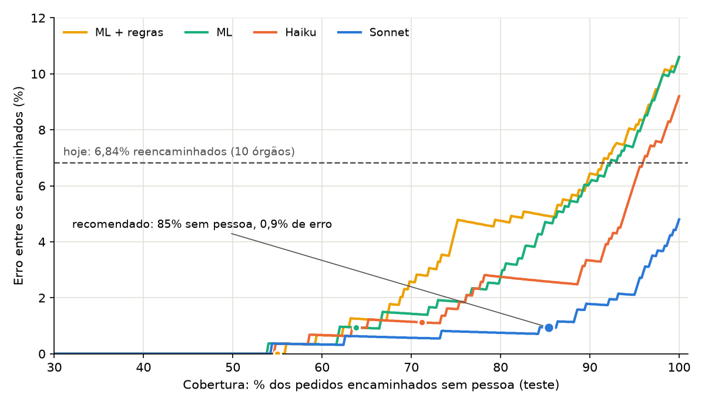

# Triagem de pedidos públicos: regras, ML clássico e IA

Dá para encaminhar pedidos de cidadãos ao órgão certo de forma automática e segura? Quanto da fila dá para automatizar sem aumentar o erro? Este projeto compara quatro abordagens no mesmo teste e decide onde a IA entra e onde uma pessoa decide.

**Veja funcionando: [mesa-triagem.vercel.app](https://mesa-triagem.vercel.app/)** (a Mesa de Triagem, com 29 pedidos de exemplo e o painel).

Para um diretor: [DECISAO.md](DECISAO.md) (uma página). Gráficos: [relatório](https://mesa-triagem.vercel.app/relatorio.html). Diário do trabalho: [PROGRESSO.md](PROGRESSO.md).

**Resumo:**
- A recomendação é o Claude Sonnet encaminhando sozinho os pedidos claros e passando os incertos para uma pessoa.
- **Em pedidos novos de janeiro e fevereiro de 2026 somados** (1.000 pedidos), a mesa encaminhou 86,1% sem pessoa, com **1,28% de erro** na parte automática (pode variar de 0,7% a 2,3%): cerca de 11 erros por 1.000 pedidos.
  - Janeiro: 0,69%. Fevereiro: 1,87%.
- **A regra erra cerca de 1% a 2% na parte automática e oscila de mês a mês. A meta de 1% não se sustentou em fevereiro.**
- Uma versão com consulta à estrutura oficial do governo não melhorou o resultado (§4b).

## 1. A dor

Em 2025, **8,52% dos pedidos de acesso à informação federais chegaram ao órgão errado**: 11.111 de 130.407.
- 6,58% foram reencaminhados a outro órgão.
- 2,23% receberam "não é de nossa competência".

O reencaminhado leva **4 dias a mais**: a mediana do prazo foi de 17 dias, contra 13 dos que chegaram certo. Todos os reencaminhados tiveram o prazo prorrogado.

Fonte: base pública do Fala.BR (CGU). Os números saem de `make dor` (`results/dor.json`).

**Régua usada na decisão (§5).** O sistema só escolhe entre os 10 órgãos estudados. Por isso, a comparação com hoje usa os reencaminhados desses 10 órgãos: 6,84%, ou 68 por 1.000. Os 8,52% acima valem para todos os órgãos federais e incluem os "sem competência".

## 2. O que foi feito

- **Dados.** 17.778 pedidos dos 10 órgãos federais com mais pedidos com texto público: MS, PETROBRAS, ANVISA, BACEN, INSS, MF, MGI, MEC, ANEEL e PF.
- **Rótulo.** O órgão que respondeu. Nos reencaminhados, é o órgão final.
- **Separação por data.**
  - Treino: janeiro a agosto (16.778 pedidos).
  - Ajuste (dev): setembro e outubro (500).
  - **Teste: novembro e dezembro (500)**, separado antes de escrever qualquer classificador.
- **Dados pessoais mascarados antes de qualquer uso.** Nome, CPF, e-mail, telefone, endereço e documentos. Como funciona e quanto escapa: [DADOS.md](DADOS.md) §7.
- **Quatro abordagens:**
  1. **Regras:** nome e sigla de cada órgão, mais palavras-chave tiradas do treino.
  2. **ML clássico:** TF-IDF e regressão logística.
  3. **Claude Haiku 5.5:** poucos exemplos no prompt; responde em JSON com o órgão, um trecho do pedido e uma justificativa curta.
  4. **Claude Sonnet 5.5:** o mesmo prompt.
- **Confirmação em dados novos.** A regra escolhida foi congelada e medida uma vez em 500 pedidos de janeiro de 2026 (holdout), com o hash registrado antes.
- **Escolhas só no dev.** O teste só mede. Cada cálculo do teste fica registrado em `results/registro_avaliacoes_teste.jsonl`.
- **Escopo: só triagem.** Nada de resposta automática ao cidadão.

## 3. As quatro abordagens no teste

500 pedidos. Entre colchetes, o intervalo de 95%.

| Abordagem | Acurácia | F1 macro | Pedidos que citam a sigla (146) | Que não citam (354) | Reencaminhados (34) | Custo por 1.000 | Tempo | Explicação |
|---|---|---|---|---|---|---|---|---|
| Regras | 74,0% [70,0–77,7] | 0,731 | 97,3% | 64,4% | 18 | ≈ 0 | < 1 ms | palavras encontradas |
| ML clássico | 89,4% [86,4–91,8] | 0,888 | 95,9% | 86,7% | 24 | ≈ 0 | < 1 ms | termos de maior peso |
| Haiku 5.5 | 90,8% [88,0–93,0] | 0,903 | 99,3% | 87,3% | 30 | US$ 0,15 | 1,3 s | trecho do pedido + frase |
| **Sonnet 5.5** | **95,2% [93,0–96,8]** | **0,944** | 98,6% | **93,8%** | **31** | US$ 2,83 | 2,0 s | trecho do pedido + frase |

Tempos dos LLMs: mediana por pedido. O custo usa tokens reais e o preço oficial.

**O que a tabela diz:**
- **O Sonnet é o melhor.** Ganha do ML por 5,8 pontos [3,0 a 8,4], nos mesmos pedidos.
- **O Haiku empata com o ML.** A diferença é de 1,4 ponto [−1,4 a 4,2]. Ele custa mais e é mais lento. No F1 de MGI e MF, o ML é melhor.
- **As regras só funcionam quando o pedido cita a sigla.** Com sigla, empatam com os LLMs (142 de 146). Sem sigla, caem para 64%. Quase toda a vantagem das regras vem da sigla: com o peso dela zerado, a acurácia cai de 74,0% para 60,4%.
- **A explicação dos LLMs é verificável:** o trecho citado está mesmo no pedido em 97% das respostas.
- **Em dados novos, a ordem se mantém.** No holdout de janeiro de 2026, o Sonnet acertou 95,4% [93,2–96,9] e o ML, 88,0% [84,9–90,6] (§4).

Fontes: `results/marco2.json` e `results/marco3.json`.

## 4. A curva: quanto a máquina pode fazer sozinha

Cada estratégia dá uma nota de confiança a cada pedido. Acima de um limiar, o pedido é encaminhado sozinho. Abaixo, vai para um servidor. Ir para a direita é automatizar mais e errar mais.



Para cada meta de erro, o limiar foi escolhido no dev. A meta de 1% foi adotada depois de ver o teste (§6). Por isso, o limiar foi **congelado** e medido em dados novos: 500 pedidos de janeiro de 2026. O hash desse conjunto foi commitado antes de rodar qualquer modelo (commit `75ebd4c`, de 10/11/2026 às 16:12 (horário de Brasília), antes da primeira chamada ao modelo no holdout), e houve uma rodada só.

**Resultado no holdout de 2026** (número principal):

| Regra congelada | Encaminhados sem pessoa | Erro entre eles [IC 95%] | Meta cumprida? | Reencaminhados que a máquina pegou certo | No teste de 2025 |
|---|---|---|---|---|---|
| **Sonnet, meta de 1%** | **86,6%** | **0,69% de erro (IC 95% 0,24–2,02%)** | **sim em janeiro** (no ponto; o intervalo vai até 2%). **Em fevereiro, não: 1,87%** (§5) | 12 de 12 | 85,4%, com 0,9% de erro |
| Sonnet, meta de 2% | 94,6% | 2,33% [1,30–4,12] | não | 15 de 17 | 96,6%, com 3,1% de erro |
| ML, meta de 1% | 67,2% | 1,49% [0,64–3,44] | não | 8 de 9 | 63,8%, com 0,9% de erro |
| ML, meta de 2% | 73,6% | 2,17% [1,11–4,23] | não | 9 de 11 | 69,6%, com 1,4% de erro |

- O holdout tem 23 pedidos reencaminhados.
- **Sem abstenção, a máquina acerta:** o Sonnet, 19 dos 23; o ML, 14.
- **Com a regra do Sonnet a 1%:** 12 dos 23 ficaram com a máquina, que acertou todos; os outros 11 foram para uma pessoa.
- Fontes: `results/holdout_2026_resultado.json` (`make holdout`) e `results/marco4.json` (`make abstencao`).

**A certeza humana separa o fácil do difícil, como a confiança do modelo.**
- **Quem classificou:** um leigo sem treino (eu), às cegas, 50 pedidos de 2025, 5 por órgão. Para cada um, marcou o órgão e uma certeza de 1 a 3.
- **Comparação justa:** os 50 vieram do treino, por isso regras e ML foram retreinados sem eles.
- Acertos por nível de certeza do leigo:

| Certeza do leigo | Pedidos | Leigo | Regras | ML | Haiku | Sonnet |
|---|---|---|---|---|---|---|
| 3 (seguro) | 14 | 12 | 13 | 13 | 13 | 13 |
| 2 | 22 | 15 | 18 | 21 | 20 | 21 |
| 1 (chute) | 14 | 3 | 9 | 9 | 12 | 13 |

- **A certeza do leigo separa o fácil do difícil.** Com certeza 3, ele acerta 12 de 14; com certeza 1, acerta 3 de 14.
- **As máquinas também caem nos casos em que o leigo chuta,** mas não todas igual: regras e ML acertam 9 de 14, e os LLMs, 12 e 13.
- **Nos 14 pedidos em que eu (leigo) tive certeza baixa, acertei 3 e o Sonnet acertou 13. É aí que o modelo mais ajuda.**
- **A confiança do Sonnet funciona nesses 50:** quando ele disse "alta", acertou 37 de 37.
- **O resultado do leigo é um limite inferior.** A ferramenta de revisão listava MJSP em vez de PF, e 3 pedidos da PF ficaram como "Outro". A amostra é pequena.
- Fonte: `results/revisao_manual.json` (`make revisao`). Detalhes em DADOS.md §7b.

## 4b. A IA com consulta à estrutura do governo (v2): não ganhou

**A ideia.** No teste de 2025, vários erros vinham de a IA não saber a qual órgão uma unidade pertence (o Arquivo Nacional, por exemplo, é do MGI). A v2 dá ao Sonnet uma ferramenta que consulta a estrutura oficial do governo federal, o SIORG, com 15.971 unidades. Ele pode consultar até 2 vezes por pedido.

**Como foi testada, sem trapaça.**
- O limiar da v2 foi escolhido em janeiro de 2026, com o mesmo critério da v1.
- Antes de rodar fevereiro, prompt, ferramenta, tabela, limiares e o hash dos 500 pedidos foram commitados juntos (`results/marco7_congelado.json`).
- Em fevereiro, v1 e v2 rodaram uma vez, nos mesmos pedidos.

**Resultado em fevereiro de 2026** (500 pedidos novos; `results/marco7_fev.json`):

| | v1 (recomendada) | v2 (com consulta) |
|---|---|---|
| Acurácia | 93,0% [90,4%–94,9%] | 93,6% [91,1%–95,4%] |
| Sem pessoa, na regra de 1% | 85,6% | 89,2% |
| Erro na parte automática [IC 95%] | **1,87%** [0,95%–3,64%] | 2,69% [1,55%–4,64%] |
| Custo por 1.000 pedidos | US$ 2,56 | US$ 2,81 |

- **A v2 empata com a v1.** A diferença é de 0,6 ponto, com IC de -0,6 a 1,8. A v1 continua recomendada, por ser mais simples e mais barata.
- **A ferramenta foi usada em 12 de 500 pedidos** (18 consultas). Corrigiu 2 erros da v1 e não causou nenhum. Em janeiro, foram 4 pedidos, sem efeito.

**Por que a ferramenta quase não foi usada, em linguagem simples.**
1. **Em 2026, poucos erros dependem de sigla de unidade.**
   - Dos 23 erros da v1 em janeiro, só 1 cita uma sigla que a tabela liga ao órgão certo.
   - A conta olha só siglas; nomes por extenso não entram.
   - Em fevereiro, 5 dos 8 erros automáticos foram casos em que a IA estava em dúvida e o ML concordou com ela: os dois erraram juntos.
2. **A busca é estrita.** Ela só acha a unidade se o texto consultado for a sigla exata ou um pedaço exato do nome. O modelo às vezes consultou do jeito que o pedido escrevia: um nome de unidade com a sigla grudada no fim, ou um código de compras. Nesses casos a tabela não achou nada.
   - Em janeiro, 6 das 7 consultas voltaram vazias; em fevereiro, 13 das 18.
   - Fonte: `results/marco7_diagnostico.json` (`python -m triagem.marco7 diagnostico`).

**Próximo passo (não implementado): busca aproximada.** Ela acharia a unidade mesmo com palavras a mais, abreviações ou erros de digitação. Só vale testar se os erros de unidade voltarem a pesar, como no teste de 2025.

## 5. A decisão

**O Sonnet encaminha sozinho quando declara confiança "alta", ou confiança "média" com o ML clássico concordando (probabilidade ≥ 0,8035). O resto vai para uma pessoa.**

A regra foi congelada e medida em dois meses de pedidos novos, 500 em janeiro e 500 em fevereiro de 2026:

| Por 1.000 pedidos dos 10 órgãos | Hoje (o cidadão escolhe) | **Com a recomendação, jan+fev/2026** | Janeiro | Fevereiro |
|---|---|---|---|---|
| Encaminhados sem pessoa | 0 | **861** | 866 | 856 |
| Triados por uma pessoa (erro não medido) | — | **139** | 134 | 144 |
| Erros de destino na parte automática | 68 reencaminhados | **11 (faixa de 6 a 20)** | 6 | 16 |
| Erro entre os encaminhados sem pessoa | — | **1,28% (pode variar de 0,7% a 2,3%)** | 0,69% | 1,87% |
| Dias de atraso somados | 274 | 44 + erros da triagem humana | 24 | 64 |
| Custo de API | 0 | US$ 2,54 | US$ 2,52 | US$ 2,56 |

Contagem direta nas amostras de 500 pedidos de cada mês, sem reponderação (`results/manchete.json`, `python -m triagem.manchete`).

**Como ler a tabela**
- **"Hoje"** é a régua do §1: os reencaminhados dos 10 órgãos.
- **Os ~11 erros por 1.000** são só da parte automática, que cobre 86% dos pedidos. O erro dos 14% que vão para uma pessoa não foi medido.
- **As contas** usam 4 dias de atraso por reencaminhamento.

**Por que esse ponto**
- **Medido duas vezes em dados novos, com resultados diferentes.** Em janeiro de 2026, a parte automática teve 0,69% de erro (IC 95% 0,24–2,02%), com 86,6% da fila saindo sem ninguém tocar. A meta de 1% foi cumprida no ponto, mas o intervalo de 95% vai até 2%.
- **Em fevereiro de 2026, a mesma regra não segurou a meta.** Com o limiar congelado, a parte automática errou **1,87%** (IC 95% 0,95%–3,64%), acima de 1%, com 85,6% sem pessoa.
  - Em 5 dos 8 erros, a IA estava em dúvida (confiança média) e o ML concordou com ela: os dois erraram juntos.
  - O resultado de um mês não basta para fixar o limiar. O Marco 8 acompanha o erro mês a mês e propõe quando recalibrar.
- **A abstenção separa os difíceis.** Nos pedidos que sobram para uma pessoa, a máquina acertaria só 70%.

**O ML clássico sozinho não segurou a meta.** No holdout, o ML com o limiar de 1% errou 1,49% [0,64–3,44] e cobriu 67%. Se mandar texto para uma API externa não for aceitável, ele ainda reduz o erro de destino, mas com mais erro e menos cobertura que o Sonnet.

**O custo da API é pequeno:** US$ 2,52 por 1.000 pedidos no holdout, menos de 1 centavo de dólar por pedido. A escolha é de cobertura, erro e política de dados, mais do que de dinheiro.

## 6. O que deu errado

- **A meta combinada falhou no teste e de novo no holdout.**
  - A meta era 2% de erro. No dev, o Sonnet chegaria a 95,6% de cobertura com 1,88%. No teste, errou **3,1%**; no holdout de 2026, **2,33%**.
  - O limiar ficou na borda da curva, e 500 pedidos de dev não sustentam uma borda tão fina.
  - Passei a recomendar o ponto de 1%, também escolhido no dev, mas **depois de ver o teste**.
  - Para não ficar com um número escolhido a dedo, congelei esse limiar e medi em 500 pedidos novos (janeiro de 2026), com o hash commitado antes (`75ebd4c`, 10/11/2026). Em janeiro ele se manteve: 0,69% de erro (IC 95% 0,24–2,02%), com cobertura de 86,6%. Em fevereiro, não: 1,87% (IC 95% 0,95–3,64%).
- **Nomes de pessoa escaparam da máscara e foram enviados à API.**
  - **Medida:** rodei um detector offline em todos os 1.570 textos enviados:
    - os 1.000 de dev e teste;
    - os 500 do holdout;
    - os 50 da revisão manual;
    - os 20 exemplos do prompt.
  - **Como o detector funciona:** procura três padrões:
    - um prenome da lista do IBGE seguido de sobrenome;
    - uma pista ("Proprietário:", "Sr.", "naturalização de"…) seguida de nome;
    - uma palavra em maiúsculas logo depois de um `[NOME]`.
  - Ele marcou 75 textos, e li todos.
  - **Resultado:** **7 textos (0,45%) tinham nome de pessoa sem máscara**. Os outros 68 eram lugares, ruas, órgãos, cargos e termos técnicos.
    - Em 3, o nome ou prenome inteiro: o de quem fez o pedido, escrito no meio do texto; um prenome estrangeiro, fora da lista do IBGE; um nome depois de "Proprietário:".
    - Em 4, sobrou o sobrenome depois do prenome mascarado (ex.: `[NOME] SOBRENOME`).
  - **É um limite inferior.** Um nome estrangeiro solto, sem pista, passaria pelo detector.
  - Fonte: `results/pii_detector_offline.json`, só com ids. São pedidos que a CGU já publica em dados abertos. Os textos não estão neste repositório, exceto os 29 exemplos da Mesa, que foram revisados à mão.
  - `make varredura` confere que nenhum trecho de 8 palavras de algum pedido aparece nos arquivos versionados. É um passo manual antes de cada commit; não há hook que o force.
- **O teste foi calculado mais de uma vez no Marco 2,** antes de existir o registro de avaliações. Nenhuma escolha mudou por isso. Está documentado em PROGRESSO.md.

## 7. O que a IA errou feio

O Sonnet errou 24 dos 500 pedidos. Li 20 deles, sorteados, ao lado do texto. Revisei comigo 3 classificações que o verificador contestou (`results/erros_classificacao_manual.json`):

| Tipo de erro | Casos | O que significa |
|---|---|---|
| Sem pista no texto | 8 | "Contracheque", "consultar débitos", o número de um pregão, a venda de um imóvel sem dizer de quem é. Nenhum classificador acerta; o certo é passar para uma pessoa. |
| Vinculação institucional | 6 | Não sabia que o Arquivo Nacional é do MGI (mandou 3 pedidos de naturalização para a PF), nem que as cepas da vacina da gripe saem em norma da ANVISA. |
| Mais de um órgão / rótulo discutível | 5 | A resposta é defensável. Dois desses a própria administração reencaminhou. Em "CPF bloqueado com dinheiro retido", o texto aponta para a Receita e para o BACEN. |
| Fato inventado | 1 | Disse que um grupo de destinação de bens da União tratava de armas apreendidas. |

**Três erros vieram com confiança "alta":**
- naturalização para a PF (era do Arquivo Nacional, no MGI);
- uma resolução do Conselho Monetário Nacional para o BACEN (foi reencaminhada ao MF);
- as cepas da vacina para o MS (era da ANVISA).

A abstenção não pega esses erros. Eles são o risco que fica.

Os erros de vinculação seriam fáceis de corrigir no prompt (Arquivo Nacional e SPU no MGI, por exemplo). Não corrigi, porque seria ajustar depois de ver o teste.

## Como trabalhei com IA

- **Divisão do trabalho:**
  - Eu defini o problema, as regras de avaliação e os pontos de parada: quando o Claude Code tinha de parar e me chamar, como antes de gastar com a API ou se aparecesse dado pessoal.
  - O Claude Code implementou o código, rodou os experimentos e escreveu os rascunhos.
  - Um verificador independente, outra instância que não escreveu o código, conferiu cada marco.
  - Eu revisei dados à mão e tomei as decisões.
- **Cinco decisões minhas:**
  1. **Normalizar MJSP → PF e assumir a limitação.** Na revisão manual, a ferramenta listava o Ministério da Justiça no lugar da Polícia Federal. Tratei os dois como PF e escrevi que o resultado humano é um limite inferior.
  2. **Tirar o relato sensível da Mesa.** Mesmo aprovado antes, um dos exemplos era um relato longo de uma pessoa em situação vulnerável. Saiu sem substituto.
  3. **Recusar a Batch API em fevereiro.** Ela custaria até metade, mas mudaria as condições em relação a janeiro. Preferi a comparação limpa.
  4. **Mandar rodar fevereiro mesmo esperando empate.** O resultado de janeiro sugeria que a v2 não ganharia, mas só um teste novo, registrado antes, responde. Ele também mostrou que a regra da v1 errou 1,87% em fevereiro.
  5. **Congelar tudo antes de cada holdout.** Prompt, ferramenta, tabela, limiares e o hash dos pedidos foram commitados antes de qualquer chamada, para que nenhum número fosse escolhido depois de visto.

## 8. Limitações

- **Federal como análogo de municipal.**
  - Os órgãos federais são mais especializados que as secretarias de uma prefeitura, e os pedidos LAI são mais formais que os de ouvidoria.
  - Não há base pública municipal com o texto do pedido; a da Ouvidoria de BH só tem categorias.
- **Dez órgãos, não todos.** O sistema não sabe dizer "não é de nenhum destes". Os 2,23% de "sem competência" ficaram fora.
- **O rótulo é o órgão que respondeu.** Pode haver pedido respondido pelo órgão errado sem registro.
- **O teste é pequeno.** São 500 pedidos e só 34 reencaminhados; os intervalos de confiança estão em todas as tabelas.
- **O teste foi estratificado,** com mínimo de 25 por órgão (`MIN_POR_ORGAO_TESTE` em `src/triagem/config.py`). Os números por 1.000 pedidos estão reponderados pela distribuição real; sem abstenção, o erro do Sonnet sobe de 4,8% para 6,3%.
- **O erro da triagem humana não foi medido.** A revisão manual de 50 casos foi feita por um leigo sem treino (§4) e não mede o erro de um servidor.
- **A máscara de dados pessoais não é perfeita** (ver §6).

## 9. O que testar com uma prefeitura real

1. **Medir o erro de destino de hoje** no sistema da prefeitura: quantos pedidos trocam de secretaria e quanto atrasam.
2. **Rodar em sombra por um mês.** A máquina sugere e o servidor decide, sem mudar o fluxo. Isso mede a cobertura e o erro reais, com um limiar escolhido com margem.
3. **Medir o erro do servidor** na mesma amostra. Sem isso, não dá para saber o ganho líquido.
4. **Pôr no prompt a estrutura da prefeitura** (quem cuida de quê, unidades vinculadas). Foi a maior fonte de erro no teste de 2025. Em 2026, pesou pouco (§4b), mas a estrutura de uma prefeitura é menos conhecida pelo modelo que a federal.
5. **Definir a política de dados antes:** mascaramento revisado, contrato com o fornecedor da API, ou o ML local como alternativa.
6. **Incluir a saída "não é da prefeitura"** e medir quantos pedidos caem nela.

## Como reproduzir

```bash
make setup        # .venv com Python 3.11 e dependências
make all          # dados → dor → conjuntos → regras/ML → LLMs → abstenção → testes
make relatorio    # report.html e results/curva_cobertura_erro.png
make varredura    # antes de cada commit: procura dados pessoais reais nos arquivos versionados
```

**Chave da API.** Os LLMs precisam de `ANTHROPIC_API_KEY`, no ambiente ou num arquivo `.env`, que fica fora do git.
- As respostas ficam em cache (`cache/`, fora do git). Rodar de novo não gasta.
- Num clone novo, refazer tudo custa cerca de US$ 4,23: US$ 2,83 de dev e teste, US$ 1,26 do holdout e US$ 0,14 da revisão manual. `make estimar-custo` estima antes, e cada script para ao passar do seu teto.

**Conjunto de teste congelado.** `data/test.jsonl` tem 500 pedidos de novembro e dezembro de 2025, com dados pessoais mascarados.

```
SHA-256: d38c70d75a229b3d2e961b39a5b6d504ad226da644ba0d09d574aa5a9b261956
```

**Holdout de 2026, registrado antes de rodar qualquer modelo** (commit `75ebd4c`, de 10/11/2026 às 16:12 (horário de Brasília), antes da primeira chamada ao modelo no holdout).
- **Composição:** `data/holdout_2026.jsonl` tem 500 pedidos de janeiro de 2026. O recorte, a estratificação e a máscara são os mesmos do teste, e textos iguais a algum pedido de 2025 foram tirados.
- **Por que existe:** para confirmar o limiar do Marco 4, que foi escolhido depois de ver o teste.
- **Regras congeladas:** Sonnet e ML, com os limiares de 1% e de 2% escolhidos no dev (`limiares_congelados` em `results/holdout_2026.json`). Nada é reajustado.
- **O que vale:** o resultado do holdout é o número principal da decisão. Se o erro passar de 1%, isso será dito.
- **Resultado** (rodado depois do registro): `results/holdout_2026_resultado.json`, com `make holdout`.

```
SHA-256: 9c5f39d6569c39cbfd7708475eecc781702cad15cfcd12524362f189a226bc49
```

**Holdout de fevereiro de 2026 (Marco 7), registrado antes de rodar qualquer modelo** (11/11/2026).
- **Composição:** `data/holdout_2026_02.jsonl` tem 500 pedidos de fevereiro de 2026. O recorte, a estratificação e a máscara são os mesmos; foram tirados os textos iguais a algum pedido de 2025 ou de janeiro de 2026.
- **Para que serve:** medir a v1 (limiar congelado do Marco 4) e a v2 (Sonnet com a ferramenta de consulta ao SIORG, com limiar escolhido em janeiro) uma vez, nos mesmos pedidos.
- **O que ficou congelado no mesmo commit** (`results/marco7_congelado.json`):
  - o prompt e a ferramenta;
  - o código do laço;
  - a tabela do SIORG;
  - os dois limiares.
- **Garantia:** `tests/test_marco7.py` confere que nada disso mudou depois.

```
SHA-256: 1f2bd9eb5afcbd494ece8c987ae08ad506598e8c177a9664b6175c92f2995f16
```

**O texto dos pedidos não está neste repositório, com uma exceção.**
- **A exceção:** os 29 exemplos públicos da Mesa, em `mesa/dados/exemplos.json`. São mascarados e foram revisados à mão, um a um, à procura de nomes e de detalhes pessoais (dois foram recusados e um foi retirado depois).
- **A trava:** a `make varredura` só aceita esses textos se o hash de cada um estiver em `results/mesa_exemplos_aprovados.json`.
- `data/*.jsonl`, `data/*.csv` e `cache/` ficam fora do git, mesmo mascarados.
- `make all` refaz os conjuntos a partir do arquivo público da CGU, e `tests/test_conjuntos.py` confere o hash localmente.
- A CGU regera o arquivo todo dia. O hash só se reproduz com a mesma versão, cujo SHA-256 está em `results/manifesto_download.json`.

**Testes:** `make test` (pytest). Cobrem:
- o hash do teste;
- a ausência de dados pessoais no que vai para a API;
- a leitura de JSON malformado;
- métricas com casos conhecidos;
- a curva de abstenção.

| Arquivo | O que tem |
|---|---|
| [DECISAO.md](DECISAO.md) | A decisão em uma página |
| `report.html` | Gráficos (abra no navegador) |
| [DADOS.md](DADOS.md) | Dados, rótulos, separação, máscara de dados pessoais |
| [PROGRESSO.md](PROGRESSO.md) | O que foi feito em cada marco, com as decisões e as correções |
| [ROTEIRO_VIDEO.md](ROTEIRO_VIDEO.md) | Roteiro de 2 minutos |
| `results/*.json` | Todas as métricas citadas aqui |
